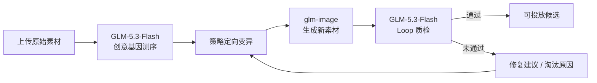

# Creative Fission Agent

广告素材裂变 Agent，一套可实际运行的「创意达尔文引擎」。

它把一条原始广告素材拆解为结构化创意基因，通过定向变异、图片生成和 Loop
质检，探索具有真实策略差异的新广告素材，而不是只替换背景、颜色或文案。

**在线演示：** https://traepary2kau.vercel.app/

## 产品能力

- **多模态基因测序**：识别卖点、人群、说服机制、钩子、情绪、场景等 10 个创意基因。
- **定向创意变异**：区分 Explore / Exploit，输出每条假设的变异基因和商业赌点。
- **真实图片生成**：调用 `glm-image` 生成新的广告图片素材。
- **Loop 质检**：从品牌、合规、质量、保真、跨模态一致性五个维度评审。
- **可观测执行**：展示模型调用、阶段状态、耗时、成本估算和质检原因。
- **双访问模式**：支持访客自带 Key（BYOK）和站长承担额度的免费公开模式。

## 运行流程



## 技术栈

- Next.js 14 App Router
- React 18 + TypeScript
- Tailwind CSS + Framer Motion
- GLM-5.3-Flash（文本推理、视觉理解、质检）
- glm-image（图片生成）
- Vercel Functions

## 快速开始

### 环境要求

- Node.js `>= 20.19`
- npm
- 智谱开放平台 API Key（BYOK 模式可在网页内填写）

### 安装

```bash
git clone https://github.com/kangjiayao14/creative-fission-agent.git
cd creative-fission-agent
npm ci
cp .env.example .env.local
npm run dev
```

访问 http://localhost:3000。

macOS / Linux 也可以运行：

```bash
./start.sh
```

## 环境变量

| 变量 | 默认值 | 说明 |
|---|---|---|
| `ZHIPU_API_KEY` | 空 | 免费公开模式所使用的服务端 GLM Key |
| `SITE_RUN_MODE` | `byok` | `byok` 或 `free` |
| `SITE_ADMIN_PASSWORD` | 空 | 站长控制台密码，必须使用强随机值 |
| `ZHIPU_BASE_URL` | 智谱 v4 API | 智谱接口地址 |
| `GLM_TEXT_MODEL` | `glm-5.3-flash` | 文本/推理模型 |
| `GLM_VISION_MODEL` | `glm-5.3-flash` | 视觉理解模型 |
| `GLM_IMAGE_MODEL` | `glm-image` | 图片生成模型 |

### 推荐部署模式

公开部署建议使用：

```dotenv
SITE_RUN_MODE=byok
SITE_ADMIN_PASSWORD=<strong-random-password>
```

该模式不会在服务器预置共享 GLM Key。访客 Key 仅保存在其浏览器中，并通过
HTTPS 随单次请求发送给 API 代理；应用不会主动把 Key 写入数据库或日志。

如需让朋友免 Key 体验，需要额外配置：

```dotenv
SITE_RUN_MODE=free
ZHIPU_API_KEY=<server-side-key>
SITE_ADMIN_PASSWORD=<strong-random-password>
```

## API 路由

| 路由 | 用途 | 模型 |
|---|---|---|
| `POST /api/sequence` | 图片素材 → 创意基因组 | GLM-5.3-Flash |
| `POST /api/mutate` | 基因组 → 创意假设 | GLM-5.3-Flash |
| `POST /api/generate` | 创意提示词 → 新图片 | glm-image |
| `POST /api/qa` | 新素材 → 五维质检 | GLM-5.3-Flash |
| `GET/POST /api/mode` | 读取/切换访问模式 | - |

## 项目结构

```text
app/
  api/                 后端 API 路由
  studio/              裂变工作台
  pages/               产品页面说明
  validation/          验证方案
components/            导航、访问控制、日志、基因组件
lib/
  client.ts            前端 API 客户端与错误处理
  glm.ts               智谱 API 客户端
  genome.ts            创意基因数据结构
scripts/               Word / PDF 项目文档生成器
```

## 常用命令

```bash
npm run dev          # 本地开发
npm run typecheck    # TypeScript 检查
npm run build        # 生产构建
npm run check        # 类型检查 + 生产构建
npm run gen:docs     # 生成 Word / PDF 项目计划书
```

## Vercel 部署

1. 在 Vercel 导入本 GitHub 仓库。
2. Framework Preset 选择 Next.js。
3. 在 Environment Variables 中设置访问模式和所需密钥。
4. 部署后检查 `/studio`，再运行一次完整裂变任务。

图片生成可能需要一分钟以上。项目已为生成接口配置更长的 Function Duration，
并对限流、非 JSON 网关响应和平台中断提供结构化错误信息。

## 安全说明

- `.env.local`、Vercel 项目文件、生成文档与内部草稿均不会进入 Git。
- 不要使用 `NEXT_PUBLIC_*` 保存任何服务端密钥。
- 不要把真实 Key 写入 `.env.example`、README、Issue 或日志。
- 发现安全问题请遵循 [SECURITY.md](SECURITY.md)，不要公开提交漏洞细节。

提交前可运行：

```bash
git grep -nE 'API_KEY=.+|Authorization: Bearer .+'
```

## 文档

```bash
npm run gen:docs
```

生成文件位于 `docs/`，默认被 Git 忽略，避免仓库包含大体积或内部交付材料。

## License

This project is source-available for evaluation and portfolio demonstration.
Commercial use, redistribution, and sublicensing require explicit permission.
See [LICENSE](LICENSE).
